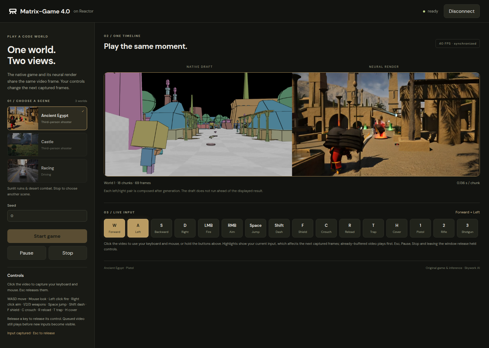

# Matrix-Game 4.0 on Reactor

Play [Matrix-Game 4.0](https://github.com/SkyworkAI/Matrix-Game/tree/main/Matrix-Game-4)
through [Reactor](https://reactor.inc). Control the original game and see its
low-poly draft beside the generated view. Each generated frame travels beside
its matching draft in one video track.



## What this integration adds

- A Reactor service using the released Matrix-Game inference implementation.
- An explicit **Connect → choose scene → Start game** workflow, live controls,
  pause and stop. Choose Ancient Egypt, Castle or Racing from gameplay screenshots.
- A small browser client with synchronized draft/render playback, live key
  highlights and on-screen controls.
- One initial frame, then four frames per generated chunk. Frames stream as
  chunks complete; the service does not wait for a complete video.

The game handles physics, gameplay, camera motion and scene construction. Its
rendered RGB frames condition the video model. Racing can also use the game's
frame-aligned dynamic captions. A coding agent is not called during inference.

The released Racing model displays its supplied reference image as frame zero;
subsequent frames are generated from the matching game captures. Shooter scenes
generate their first displayed frame. This integration retains that native
first-frame behavior.

## What you need

- Linux, Docker, the [NVIDIA Container Toolkit](https://docs.nvidia.com/datacenter/cloud-native/container-toolkit/latest/install-guide.html)
  and a driver compatible with CUDA 13.2.
- One NVIDIA GPU for the released single-GPU model. Tested on one B200;
  the three-scene service used approximately 45 GiB of GPU memory.
  Smaller GPUs have not been validated by this integration.
- Working hardware EGL/OpenGL for the game capture. CUDA availability alone
  does not establish this; the game refuses software rendering by default.
- Space for the model image, game assets and weights. The complete three-scene
  resource set occupies approximately 42 GiB, plus the Hugging Face download cache.
- Node.js 22.12+ and npm for the demo.

## 1. Install the CLI

Install the [Reactor CLI](https://docs.reactor.inc/deploy/platform/installation).
Check that `reactor version` prints a version, then run the following commands
from this directory, which contains `reactor.yaml`.

## 2. Build and start the model

The service loads all three released scene checkpoints on one GPU and keeps
them resident for scene switching. `matrix_game4.yaml` selects the native
inference preset. For racing, `prompt_mode: dynamic` enables the original
engine-generated captions; `fixed` uses the released scene prompt. The two
shooter scenes always use their original fixed prompts.

```sh
reactor validate
reactor build
reactor run --gpus device=0 --port 8080
```

Select a GPU that is available to you. The image uses Reactor Runtime 3.8.3,
Python 3.12 and the original CUDA 13.2/PyTorch 2.12 inference dependencies.
The manifest builds both native game engines and pins one upstream checkout.
First startup downloads all three scenes and shared assets into
`runtime.weights_path`, checking the original manifests' file sizes and hashes.
Further starts reuse those files. Rebuild after changing configuration or code.

Check readiness from another terminal:

```sh
curl -s http://localhost:8080/health
curl -s http://localhost:8080/schema
```

Wait for `"state":"available"`. Cold initialization and the first generated
chunk can take longer than later chunks. Ctrl+C in the service terminal stops it.

## 3. Open the client

From a second terminal in this directory:

```sh
cd demo
npm ci
npm run dev -- --host 127.0.0.1
```

Open the printed URL, normally `http://localhost:5173`. The client connects to
`http://localhost:8080`. Set `VITE_REACTOR_URL` before starting or building the
frontend when using another endpoint. This demo uses the SDK's local mode; a
hosted client needs the documented server-side token exchange.

Click **Connect**, select a scene card, choose a seed and any racing options,
then **Start game**. Click the video to capture the keyboard and mouse; Esc
releases them. You can also hold the on-screen control buttons. Highlights and
the action label show your current input; buffered video can show an earlier
moment. The scene thumbnails are real generated gameplay captures.

To switch scenes, click **Stop**, choose another card, then **Start game**.
This starts a new native game with the corresponding checkpoint and clears
the previous video and rollout state. **Pause → Resume** retains the same game.

### Remote access over SSH

Forward the frontend and Runtime HTTP ports to your local machine. WebRTC also
needs a reachable media path: SSH HTTP forwarding and Docker host networking
alone do not forward UDP. Use Reactor's supported TURN-over-TCP configuration,
forward the authenticated relay's TCP listener, and verify the selected ICE
path and received video. Keep relay credentials in deployment configuration,
outside this repository. See [local testing](https://docs.reactor.inc/deploy/development/local-testing).

## Controls

| Control | Shooter scenes | Racing |
| --- | --- | --- |
| W/S, A/D | Move forward/backward, strafe | Throttle/reverse, steer |
| Mouse | Look | Chase camera follows the car |
| Left/right click | Fire / aim | — |
| 1, 2, 3 | Pistol, rifle, shotgun | — |
| Space | Jump | Handbrake |
| Shift, F, C | Dash, shield, crouch | — |
| R, T, H | Reload, trap, cover | R recovers the car in time trial |
| B | — | Service brake |
| P / Enter | — | Pause/resume the time trial or pursuit |

Release keys to release their controls. Losing pointer lock or window focus
releases held inputs. The client coalesces input while waiting for command
completion. Changes affect future game captures; already captured or buffered
frames keep playing. Both halves of the video stay paired throughout.

**Pause / Resume** holds the current world and continues its history. **Stop**
ends it, and **Start game** creates a fresh game. Racing mode and route apply on
the next start; pursuit uses the avenue route. The SDK also exposes the native
front-drive/front-grip/rear-grip settings and the `retry` race action.
Race actions are refused in free drive; recovery is also refused in pursuit,
matching the native engine. Application **Pause / Resume** is available in every
mode. After **Disconnect**, the client waits for session cleanup before allowing
another connection.

## Validation and limits

On one B200, the original loader/stream and this adapter's model half produced
identical raw uint8 RGB on the same seed-0 inputs: 62 chunks / 245 frames each
for Ancient Egypt and Castle, and 612 chunks / 2445 frames for Racing with
dynamic captions. Maximum and mean absolute pixel error were zero for these
comparisons, before video encoding. They preserve one uninterrupted native
stream, its 21-latent window and the original sink behavior.

Warm adapter model compute measured approximately 80–91 FPS across these runs,
excluding the first 21 chunks, loading, game capture and transport. This is not
end-to-end latency or a claimed speedup over upstream. The real Reactor service
also completed 668 consecutive Ancient Egypt chunks with live controls,
pause/resume, a fresh world and reconnect. Both development and production
clients received real video through relay-only TURN/TCP. Castle also passed
the real frontend flow with 118 consecutive chunks and a fresh 12-chunk world.

Racing's real frontend completed 630 free-drive chunks, plus two 103-chunk
time-trial worlds (skyway and avenue) and a 93-chunk pursuit world. Separate
62-chunk replay tests in Egypt and Racing also matched after native restart,
adapter world changes and explicit reset, with weights kept loaded.

The scene-switching frontend was also tested in one connection across Egypt,
Castle, Racing and back to Egypt: 48 / 48 / 43 / 48 chunks, 736 frames in total.
Keyboard/mouse input, on-screen controls, focus-loss release, pause/resume and
TURN/TCP reconnect passed without browser errors.

All 27 CPU tests pass. They exercise the application against a scripted model
half, model bookkeeping with fake compute, real Runtime hooks and worker IPC,
including refused steps, failed generation, world identity, seed isolation,
frame pairing, pause/resume and viewer disconnects.

The released inference presets remain intact. `realtime` uses the upstream
single-step fast path; `quality` selects the upstream two-step alternative.
The 8192-chunk horizon ends the game explicitly. Playback is fixed at **40 FPS**
to match the native game's simulation/capture clock; faster computation does
not speed up the game. The fixed-rate browser test averaged approximately
39.8 decoded FPS. Game initialization and the first chunk take longer; buffered
frames and step-boundary controls add input latency.

**Visual limits:** long tests exposed color/block artifacts in some trajectories,
including the original native renderer. The 61-second racing collision/occlusion
fixture degraded in both realtime and quality presets. Numerical parity proves
fidelity for the tested inputs; it does not guarantee stable long-horizon quality.
The screenshot above is an early real generated frame, not a quality benchmark.

This initial demo does not reproduce the upstream audio or HUD overlays. Frame
telemetry is attached to the video metadata so later presentation can use the
displayed frame rather than a newer game state. Image uploads and arbitrary
prompt edits are not exposed by this native-game interface.

## More

- [Reactor SDKs](https://docs.reactor.inc/sdk-reference/using-the-sdk) and the
  running service's `/schema` describe the client contract.
- `matrix_game4.py` owns commands and the step hooks; `matrix_game4_model.py`
  owns the runtime-independent model contract; `matrix_game4_backend.py` calls
  the original loader and stream; `matrix_game4_game.py` owns game capture.
- `reactor.yaml` pins the upstream source. The build uses that checkout even
  when this directory is placed beside another source checkout.

## Credits and licence

Thanks to [Rising0321](https://github.com/Rising0321) for porting Matrix-Game 4.0
to Reactor. Matrix-Game, its games and its model implementation are developed
by the Skywork AI Matrix-Game team. The upstream Apache-2.0 licence, NOTICE and
third-party notices remain in the pinned source; model and asset licences
remain those of their respective releases.
